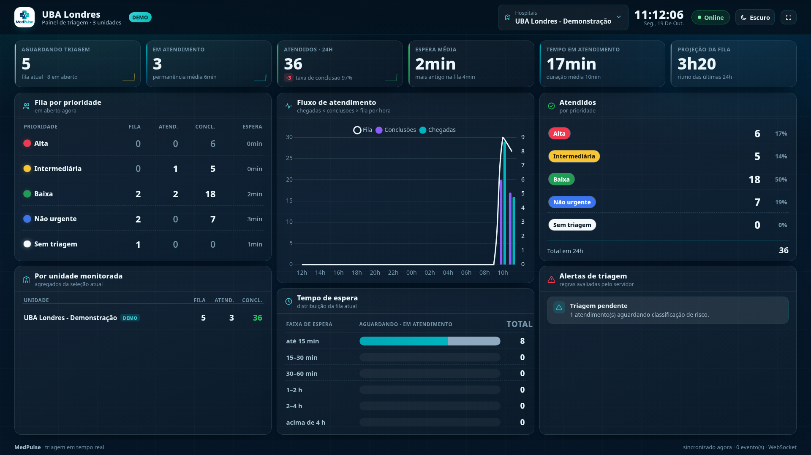

# Ambiente de demonstração (showcase)

O MedPulse acompanha um gerador sintético que mantém um hospital fictício — **UBA Londres - Demonstração** — em movimento contínuo, para que o painel possa ser apresentado sem depender de um sistema de origem real. É opcional, ligável por variável de ambiente, e escreve **exclusivamente** em hospitais marcados com `demo=True`.



## Ligar e desligar

O gerador não altera o comportamento normal da aplicação quando está desligado.

```bash
# Ligar (ambiente de demonstração)
SHOWCASE_ENABLED=true python app.py

# Desligar — o painel volta a ser puramente reativo, alimentado só pelo webhook
SHOWCASE_ENABLED=false python app.py
```

Ao subir, `services/showcase.py` inicia uma thread daemon própria e loga os hospitais atendidos. Se `SHOWCASE_ENABLED=true` mas nenhum hospital com `demo=True` existir, ele avisa (`showcase habilitado, mas nenhum hospital com demo=True existe`) e não escreve nada.

Com `DEBUG=true` o reloader do Werkzeug importa o módulo duas vezes; o gerador só liga no processo filho (`WERKZEUG_RUN_MAIN=true`), para não duplicar chegadas.

## Provisionar o ambiente

```bash
flask demo listar
# Local <uuid-do-local> - Clinica Exemplo
#   hospital 1: Hospital Central               ativo=True
#   hospital 3: UBA Londres - Demonstração (DEMO) ativo=True

flask demo init --local "Clinica Exemplo" --backlog 40
```

| Comando | O que faz |
|---|---|
| `flask demo listar` | Lista locais e hospitais, marcando `(DEMO)` os ambientes sintéticos |
| `flask demo init [--local <nome>] [--backlog <min>]` | Cria/atualiza o hospital demonstrativo e seus 10 setores (idempotente) e, com `--backlog`, preenche a fila simulando os últimos N minutos |
| `flask demo tick [--ciclos 10] [--dt <min>] [--velocidade <x>] [--semente <n>]` | Avanço determinístico, sem servidor: executa N ciclos de uma vez |
| `flask demo limpar --hospital <id> [--confirmar]` | Remove os atendimentos sintéticos daquele hospital |

`preparar_demo()` é idempotente: reexecutar não duplica hospital nem setores. Sem `--local`, ele usa o primeiro local cadastrado.

Sem `--confirmar`, `demo limpar` é *dry-run* e apenas informa quantos registros seriam removidos. Com `--confirmar`, apaga só os protocolos `DEMO-%` do hospital informado, e recusa (com erro) qualquer hospital que não seja `demo=True` — não existe caminho para apagar dado real por engano.

## Como o gerador funciona

Cada ciclo avança um Δt e aplica duas passagens sobre o hospital demo, sempre pela mesma camada de serviços usada pelo webhook (`services/atendimentos.registrar()`), portanto sujeita à mesma validação, à mesma máquina de estados e à mesma propagação por WebSocket.

**Chegadas** — contagem de Poisson com

```
lam = fluxo_base (9/h) × fator_diurno[hora] × pico × velocidade × Δt / 60
```

A curva diurna (`CURVA_DIURNA`) reproduz o ritmo de um pronto-socorro: fica em 0,12–0,25 de madrugada, sobe a partir das 6h e tem picos por volta das 9h e das 17–18h. 2% dos ciclos sorteiam um pico extra (×3). A prioridade de cada chegada é sorteada pela distribuição assistencial típica:

| Prioridade | Peso |
|---|---|
| Baixa | 33 |
| Não urgente | 28 |
| Intermediária | 20 |
| Sem triagem | 12 |
| Alta | 7 |

**Progressão** — transição exponencial `p = 1 − exp(−Δt/τ)`, com τ (tempo médio de etapa, em minutos) por status e prioridade, e portão de tempo mínimo: nenhum atendimento se move antes de 30% do τ da etapa em que está. Um paciente em `em_atendimento` com prioridade alta leva em média 48 min para concluir; um `aguardando` de prioridade alta leva 3 min para entrar em triagem.

| Status | Alta | Intermediária | Baixa | Não urgente | Sem triagem |
|---|---|---|---|---|---|
| `aguardando` | 3 | 9 | 18 | 28 | 6 |
| `triagem` | 3 | 4 | 5 | 6 | 5 |
| `em_atendimento` | 48 | 38 | 26 | 18 | 20 |

As transições emitidas respeitam exatamente `TRANSICOES`: `aguardando → triagem` (e, se estava `sem_triagem`, recebe uma prioridade sorteada), `triagem → em_atendimento` com destino por gravidade (Sala Vermelha/Emergência para alta, Sala Amarela/Observação/Consultório para intermediária, Consultórios para baixa e não urgente), `em_atendimento → finalizado` ou retorno à fila (`aguardando`, ~1,5% por minuto) e deslocamento interno para exame/observação (~4%). Desistência (`aguardando → cancelado`) ocorre em ~0,6% por minuto.

**Backlog** — `semear_backlog()` cria a fila histórica proporcional a `--backlog`, atribuindo o estado pela idade do atendimento em relação ao τ da prioridade, de modo que o painel não nasça vazio e a série horária já tenha forma.

**Ritmo** — `velocidade` escala taxas, não o relógio: com `SHOWCASE_VELOCIDADE=6` o painel mostra em 10 minutos o movimento de 1 hora real. O Δt de cada ciclo é medido desde o ciclo anterior (com teto de 10 min), então atrasos não distorcem as durações. Os intervalos entre ciclos são jitterados (0,55×–1,9× do `SHOWCASE_INTERVALO_MS`) de propósito: ciclos idênticos produziriam rajadas reconhecíveis na série temporal.

**Ruído estável vs. RNG compartilhado** — o τ e os portões de cada atendimento dependem de um ruído derivado de `(protocolo, status)`, então a mesma prioridade não evolui inteira no mesmo ciclo. Já as *decisões* de transição usam o RNG do ciclo: um RNG fixo por estado repetiria o mesmo sorteio sempre e a fila congelaria.

**Determinismo** — `--semente` torna a sequência reprodutível, o que é usado pela suíte de testes (`tests/test_showcase.py`) e serve para gravar demos idênticas:

```bash
flask demo tick --ciclos 30 --dt 4 --velocidade 6 --semente 42
```

## Isolamento (requisito de projeto)

Dados sintéticos só existem no ambiente demonstrativo:

1. **`hospitais.demo` é a fronteira.** `alvos()` consulta apenas `ativo=True AND demo=True`, e `passo()`/`semear_backlog()` revalidam a flag a cada hospital, levantando `ShowcaseIsolamento` antes de escrever.
2. **Allowlist opcional.** `SHOWCASE_HOSPITAIS=3` restringe o gerador a ids explícitos.
3. **Teto de volume.** `SHOWCASE_MAX_ABERTOS` (140) limita os atendimentos abertos simultâneos, para o hospital demo não dominar as agregações.
4. **Nada real é gerado.** Os nomes vêm de listas fixas de nomes e sobrenomes fictícios e o `protocolo` é sempre `DEMO-<hospital>-<hex>` — não há vínculo com pacientes, documentos ou sistemas reais.

Assim, hospitais reais recebem exclusivamente dados do webhook. O próprio painel evidencia a separação no card "Por unidade monitorada", onde a unidade demo aparece marcada, e o seletor tem o atalho "Somente demo" para ligar/desligar a camada sintética visualmente.

## Roteiro curto de apresentação

1. Suba com `SHOWCASE_ENABLED=true SHOWCASE_VELOCIDADE=6 python app.py` e abra `http://127.0.0.1:5000/<token-do-local>`.
2. Selecione um hospital **real** e mostre os contadores zerados — o painel não mostra dado sintético em unidade real.
3. Marque "Somente demo": os KPIs, a matriz de prioridade e a série horária se preenchem e continuam evoluindo sozinhos.
4. Aponte para um card e para a faixa de espera: são agregados, sem nome, prontuário ou setor de paciente.
5. Alterne o tema, entre em tela cheia e desligue o servidor por alguns segundos para mostrar o selo `Offline` e a recuperação com snapshot.

## Variáveis relacionadas

| Variável | Padrão | Efeito |
|---|---|---|
| `SHOWCASE_ENABLED` | `false` | Liga a thread do gerador |
| `SHOWCASE_INTERVALO_MS` | `2600` | Intervalo base entre ciclos (com jitter) |
| `SHOWCASE_VELOCIDADE` | `6` | Escala taxas de chegada e progressão |
| `SHOWCASE_MAX_ABERTOS` | `140` | Teto de atendimentos abertos no hospital demo |
| `SHOWCASE_HOSPITAIS` | vazio | Allowlist de ids; vazio = todos os `demo=True` |

## Documentos relacionados

- [Arquitetura e decisões](ARQUITETURA.md)
- [API e webhook](API.md)
- [Interface do painel de TV](UI.md)
- [Privacidade e segurança](../SECURITY.md)
- [Como contribuir](../CONTRIBUTING.md)
