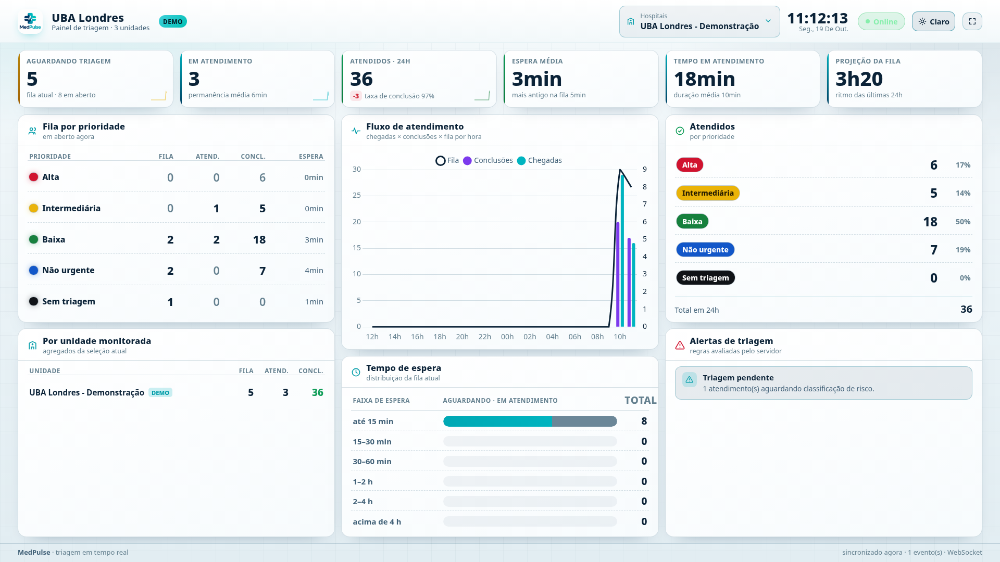
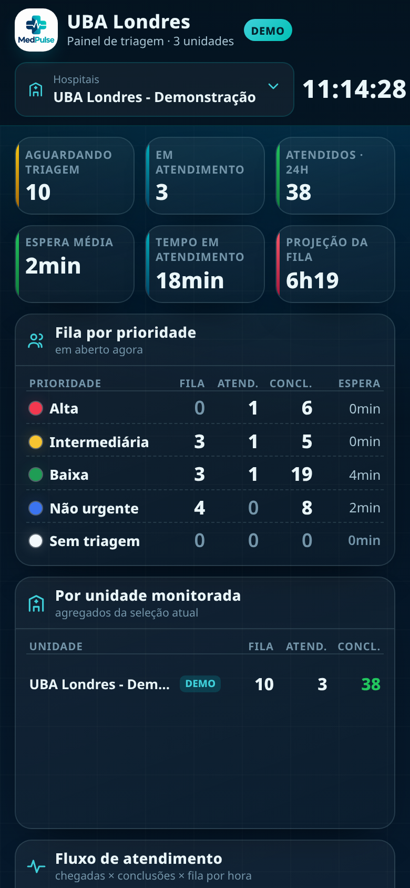
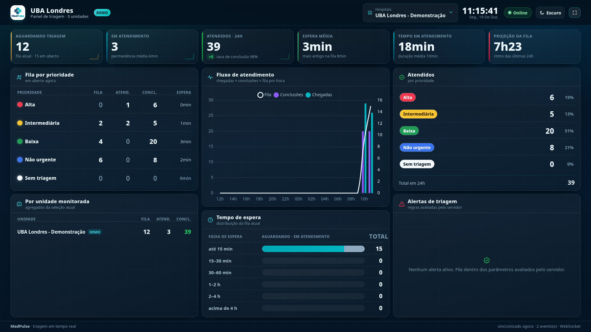

# Interface do painel de TV

O MedPulse é um mural de monitoramento para uma tela na parede: triagem de pronto-socorro, vista a distância, atualizada sozinha. Isso impõe três regras que explicam todas as escolhas de layout — **nada rola**, **nada pede interação operacional** e **nenhum dado de paciente aparece**.


## Anatomia da tela

```
┌ topo ── logo + local (selo DEMO) · seletor de hospitais · relógio · conexão · tema · tela cheia ┐
│ faixa de KPIs ── 6 cartões, um por linha, com sparkline                                            │
├───────────────┬───────────────────────┬──────────────────────────────────────────────────────────┤
│ Fila por      │ Fluxo de atendimento  │ Atendidos (por prioridade)                                 │
│ prioridade    │ (chegadas × conclusões│                                                            │
│               │  × fila, por hora)    ├──────────────────────────────────────────────────────────┤
├───────────────┤                       │ Alertas de triagem                                         │
│ Por unidade   ├───────────────────────┤                                                            │
│ monitorada    │ Tempo de espera       │                                                            │
└ rodape ── sincronizado há X · N evento(s) · WebSocket ────────────────────────────────────────────┘
```

- **Faixa de KPIs** (6 cartões): Aguardando triagem · Em atendimento · Atendidos · 24h · Espera média · Tempo em atendimento · Projeção da fila. Cada um traz um rodapé de contexto (total em aberto, permanência média, taxa de conclusão, tempo do atendimento mais antigo na fila, ritmo das últimas 24 h) e, quando há série, uma sparkline dos últimos buckets.
- **Fila por prioridade**: matriz prioridade × etapa (fila · em atendimento · concluídos · espera média), na ordem assistencial — Alta primeiro.
- **Fluxo de atendimento**: série horária de 24 buckets no fuso da operação.
- **Tempo de espera**: distribuição agregada da fila atual em faixas (até 15 min · 15–30 · 30–60 · 1–2 h · 2–4 h · acima de 4 h), separando quem aguarda de quem já está em atendimento.
- **Atendidos**: contagens e percentuais por prioridade no período.
- **Por unidade monitorada**: `aguardando`, `em atendimento` e `atendidos 24h` de cada hospital da seleção, com a unidade de demonstração marcada — o card que evidencia a separação entre dados reais e sintéticos.
- **Alertas de triagem**: regras avaliadas no servidor (`resumo.alertas`), com nível `critico`/`alto`/`medio`.

## Controles: quatro, e só

Seleção de hospitais, relógio (informativo), tema claro/escuro e tela cheia. O estado de conexão é um selo com `role="status"`, não um botão.

Não existe botão de atualização manual: os números chegam pelo WebSocket, e uma ação que duplica o caminho automático só convida a operar a TV como se fosse um sistema. O seletor aceita uma ou várias unidades, tem os atalhos **Todos** e **Somente demo** e nunca fica vazio — sem hospital selecionado o painel informa que precisa de escopo em vez de mostrar zeros. A escolha persiste por local (`medpulse:selecao:<token>` no `localStorage`).

## Privacidade no que aparece

O painel é agregado por construção. Nomes, protocolos/prontuários, documentos, alocação por setor ou leito e qualquer campo clínico **não chegam ao navegador** — a projeção `CAMPOS_PAINEL` (`services/realtime.py`) é a única lista branca de campos que atravessa a borda, em REST, snapshot e eventos. Não é ocultação por CSS: para vazar um dado pessoal seria preciso alterar o backend.

Na tela, o que seria individual vira distribuição: em vez da lista de pacientes, faixas de tempo de espera e contagens por prioridade. O estado do frontend (`static/js/state.js`) só guarda indicadores, vocabulário e contadores de eventos.

## Paleta de prioridade

Escala oficial, idêntica em matriz, cartões, contadores, legendas e gráficos:

| Prioridade | Tema escuro | Tema claro |
|---|---|---|
| Alta | `#f2384f` (vermelho) | `#d1132f` (vermelho) |
| Intermediária | `#f7c531` (amarelo) | `#eab308` (amarelo) |
| Baixa | `#1f9d55` (verde) | `#16803d` (verde) |
| Não urgente | `#3b74f0` (azul) | `#1257c9` (azul) |
| Sem triagem | `#f3f8fb` (**branco**) | `#101317` (**preto**) |

Tudo passa por tokens: `--p-alta`, `--p-intermediaria`, `--p-baixa`, `--p-nao_urgente`, `--p-sem_triagem`, cada um com o par `--p-*-fg` para o texto sobre o preenchimento. Os tons do tema claro são escurecidos para manter contraste sobre fundo branco sem trocar a leitura da cor.

As séries do gráfico de fluxo usam tokens próprios (`--serie-chegada`, `--serie-conclusao`, `--serie-fila`) justamente para que nenhuma cor de gráfico possa ser lida como prioridade de triagem, e o selo de conexão é texto + pílula, não um ponto colorido.

## Tema claro e escuro

`<html data-tema="claro|escuro">` troca apenas um atributo: todos os componentes leem as mesmas variáveis CSS (`--fundo`, `--topo`, `--surface`, `--texto-*`, `--linha`, além da escala de prioridade), então o tema persiste em `medpulse:tema`, sobrevive ao reload, atualiza o `<meta name="theme-color">` e **não interrompe o WebSocket** nem recarrega dados. As sparklines são SVG desenhado no navegador, por isso se reconstroem no canal `tema` — só de cor, sem tocar nos números.



## Como o layout não rola

`#painel` é uma coluna flex de altura exata (`100vh`) com `overflow: hidden`; `.conteudo` recebe o espaço restante com `min-height: 0`, a faixa de KPIs é fixa (`grid-template-columns: repeat(6, minmax(0, 1fr))`) e a `.grade` é 3 colunas × 2 linhas em `minmax(0, 1fr)`. Cada cartão corta o próprio excedente (`overflow: hidden`) em vez de empurrar a página.

A tipografia escala pela largura da tela — `:root { font-size: clamp(13px, .55vw + 6px, 26px) }` — e os espaçamentos acompanham (`--folga`, `--gap` em `clamp` de `vh`), com números tabulares e rótulos curtos para leitura a distância. Medido com Playwright, lendo o excedente de scroll do próprio documento:

| Viewport | Rolagem vertical | Rolagem horizontal | `rem` base |
|---|---|---|---|
| 3840×2160 (4K) | 0 px | 0 px | 26 px |
| 1920×1080 (Full HD) | 0 px | 0 px | 16,6 px |
| 1366×768 (notebook) | 0 px | 0 px | 13,5 px |

O mesmo vale para tema claro, tela cheia (os dois temas) e estado offline — nenhum cartão cortado, nenhum elemento com `overflow` residual.

Abaixo de Full HD o layout sacrifica informação, não altura: em `max-width: 1500px` somem o rodapé e a sparkline dos KPIs (a linha nunca pode virar duas), e em `max-width: 1200px` o relógio perde o rótulo e os botões perdem o texto, ficando só o ícone.

**Abaixo de 1000 px a grade de três colunas não cabe mais** — nesse intervalo, documentado de propósito, o `rem` congela em 14 px e `.conteudo` volta a rolar. Um painel de TV nunca chega lá; a TV não é o dispositivo, é a tela. O mobile apenas deixa de quebrar se alguém abrir a URL no celular.



## O dropdown no Firefox

O seletor de hospitais é um multiselect customizado (checkboxes), e antes ele simplesmente não abria no Firefox. A causa era de empilhamento: o painel suspenso era filho do cabeçalho, que tem fundo e `backdrop-filter` — o filtro cria contexto de empilhamento e recorta o excesso, e o Firefox não pintava o que saía da caixa.

A correção tem duas partes: o `<header>` ficou sem `backdrop-filter`, e o painel suspenso é **re-parenteado** para `document.body` (ou para `document.fullscreenElement`, quando há tela cheia) com `position: fixed`, posicionado pelo retângulo do gatilho. O `z-index: 200` dentro de `:fullscreen` mantém o menu acima dos cartões.

Comportamento verificado em Chromium e Firefox: abre com clique e com `Enter` no gatilho, o retângulo cabe no viewport, o *hit-test* cai sobre o próprio painel suspenso, checkbox e rótulo alternam uma única vez, clique fora e `Escape` fecham, zero erros de console.

## Tela cheia

O fundo mora em `#painel`, não em `<main>`: `#painel:fullscreen` recebe `width/height` de viewport, `display: flex`, `overflow: hidden`, `background-color: var(--fundo)` e a pintura de fundo. Como o elemento em tela cheia é o mesmo que pinta o fundo, não existe o `<main>` preto sobre o *backdrop* do navegador.



## Conexão: dois estados, sem zona cinzenta

**Online** somente enquanto o WebSocket está estabelecido; **Offline** quando ele ainda não conectou, caiu ou foi perdido. Carregar a página não conta como conexão — `estado.conexao` nasce `offline` e só muda no callback do socket (`static/js/realtime.js` usa `Boolean(socket.connected)`).

Offline também mostra uma faixa de aviso com o motivo e a política de recuperação: reconexão automática com backoff e, se o socket não volta, o painel cai para consulta REST periódica (sonda a cada 7 s) — o **modo reserva**, anunciado no rodapé como `REST (modo reserva)` — e retorna ao socket quando ele recupera, reconciliando tudo pelo snapshot.

O store adicionalmente descarta o agregado cujo escopo não bate com a seleção atual: cada resposta carrega `resumo.hospitais`, então cliques rápidos que produzem respostas fora de ordem não misturam unidades na tela.

## Relógio do servidor

A referência temporal é o fuso da operação (`TIMEZONE`, IANA → `FUSO_HORARIO`), não o da TV. `/api/config` entrega `fuso_horario`, `agora_utc` e `agora_local`; o navegador guarda **apenas o deslocamento** servidor−navegador e formata com `Intl.DateTimeFormat({ timeZone })`.

O deslocamento é recalculado com os agregados que já passam pelo socket (`resumo.gerado_em`), sem requisição extra de horário; entre sincronizações o relógio avança localmente a cada segundo. Uma TV sem hora, sem fuso ou em outro continente mostra a hora certa do hospital. Se o fuso vier desconhecido para o navegador, o fallback ainda mostra a hora do servidor.

## Módulos do frontend

| Arquivo | Papel |
|---|---|
| `static/js/main.js` | Bootstrap: monta componentes, sincroniza relógio, liga socket e seleção |
| `static/js/state.js` | Único store: seleção, resumo, vocabulário, tema, conexão, contadores, persistência |
| `static/js/api.js` | Cliente REST (`/api/config`, `/locais/<token>`, `/resumo`, `/atendimentos`) |
| `static/js/realtime.js` | Socket.IO: assinatura por sala, snapshot, backoff, sonda REST, estado de conexão |
| `static/js/relogio.js` | Deslocamento servidor↔navegador e formatação no fuso do servidor |
| `static/js/ui/dom.js` | Helpers de criação de elementos, ícones, formatação de minutos |
| `static/js/ui/multiselect.js` | Seletor de hospitais com atalhos e painel suspenso portalizado |
| `static/js/ui/kpis.js` | Faixa de 6 indicadores com sparkline |
| `static/js/ui/filas.js` | Matriz fila × prioridade |
| `static/js/ui/espera.js` | Distribuição de tempo de espera por faixa |
| `static/js/ui/atendidos.js` | Atendidos por prioridade com percentuais |
| `static/js/ui/graficos.js` | Chart.js: fluxo de atendimento |
| `static/js/ui/alertas.js` | Lista de alertas vindos do servidor |
| `static/js/ui/hospitais.js` | Card "Por unidade monitorada" |
| `static/js/ui/status.js` | Selo de conexão, faixa de aviso, relógio, tela cheia, rodapé |
| `static/js/ui/tema.js` | Botão de tema e atributo `data-tema` |

Cada componente se inscreve nos canais de que precisa (`inscrever(['resumo', 'meta'])`) e só ele se redesenha quando aquele canal muda — nada de `innerHTML` global ou re-render da árvore inteira. Os assets de terceiros (Chart.js, socket.io) estão vendorizados em `static/vendor/`: nenhuma dependência de CDN, requisito para uma TV em rede isolada.

## Documentos relacionados

- [Arquitetura e decisões](ARQUITETURA.md)
- [API e tempo real](API.md)
- [Ambiente de demonstração](DEMO.md)
- [Critérios de aceite e evidências](VALIDACAO.md)
- [Como contribuir](../CONTRIBUTING.md)
